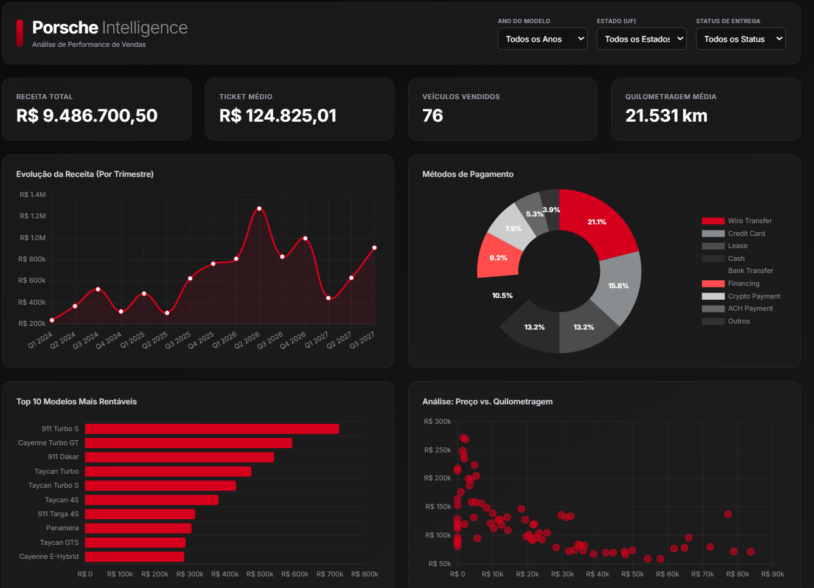
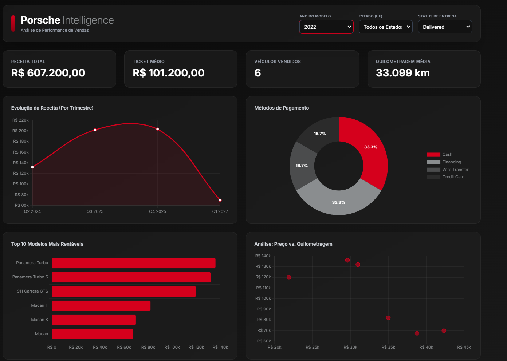

# 🏎️ Porsche Sales Intelligence Dashboard

**🚀 Aceda ao dashboard em produção:** [https://github.com/artuart-little/DIO-ReclameAqui_DesafioDashboard](https://github.com/artuart-little/DIO-ReclameAqui_DesafioDashboard)

---

## 📌 Sobre o Projeto
Este projeto consiste na transformação de uma base de dados bruta de vendas de veículos da Porsche num dashboard web interativo, sem dependência de plataformas tradicionais de BI (como Power BI ou Tableau). 

A arquitetura foi desenhada num **único ficheiro HTML (Serverless)**, embutindo os dados em JSON para garantir máxima performance e permitindo o alojamento estático via GitHub Pages. O foco do projeto foi aplicar boas práticas de visualização de dados (Data Storytelling) e UI/UX.

## ❓ Perguntas de Negócio Escolhidas
Para garantir que o dashboard fosse uma ferramenta analítica útil, direcionei a visualização para responder a questões estratégicas:

1. **Existe correlação entre a quilometragem do veículo e o seu preço de venda?**
   * *Porquê:* Ajuda a entender a curva de depreciação dos veículos usados/seminovos no mercado local.
   * *Como:* Respondida através do **Gráfico de Dispersão (Preço vs. Quilometragem)**, com conversão automática de milhas imperiais para quilómetros (fator 1.609).
2. **Quais são os modelos exatos que trazem maior retorno financeiro?**
   * *Porquê:* Essencial para direcionar campanhas de marketing e otimizar o stock.
   * *Como:* Respondida através do **Gráfico de Barras Horizontais**, focado estritamente no **Top 10 Modelos Mais Rentáveis**, ordenados do maior para o menor.
3. **Qual é o comportamento financeiro dos clientes?**
   * *Porquê:* Permite à área financeira otimizar parcerias e antever o fluxo de caixa a longo prazo.
   * *Como:* Analisado através do crescimento da **Receita por Trimestre** (para suavizar a visualização de tendências) e da distribuição de pagamentos no **Gráfico de Rosca** (com métodos marginais agrupados em "Outros").

## 🧹 Tratamento da Base de Dados (ETL)
Antes de enviar os dados para a IA, foi necessário um processo de sanitização (ETL) realizado diretamente no **Microsoft Excel**:
1. **Remoção de Redundâncias:** Exclusão das colunas de dados originais (raw), mantendo apenas as colunas previamente limpas (ex: *SalesPriceSanitized*).
2. **Limpeza de Anomalias Temporais:** Filtrei e eliminei registos que continham a string `"INVALID"` na coluna de datas (erros como 30 de fevereiro), o que quebraria o eixo temporal dos gráficos.
3. **Otimização para a IA:** Os cabeçalhos foram renomeados para formatos curtos e sem espaços (ex: `SaleDate`, `PorscheModel`, `SalesPrice`).
4. **Exportação:** A base final foi exportada como `.csv` (UTF-8) para gerar um ficheiro leve.

## 🤖 Engenharia de Prompt e IA Utilizada

**Ferramenta Utilizada:** Optei por utilizar o **Google Gemini** para a geração iterativa do código Front-end.

**A Evolução e Refinamento do Código:**
Em vez de aceitar a primeira versão gerada pela IA, apliquei conceitos críticos de análise de dados para refinar o output em múltiplas iterações:
* **Conversão de Unidades e Formatação:** Solicitei ao script que formatasse eixos financeiros longos com abreviaturas ("k" e "M") e que convertesse os dados de Milhagem para Quilómetros (multiplicando por 1.60934) para adequação ao sistema métrico.
* **Redução de Ruído Visual:** O gráfico de linha diário/mensal apresentava picos irregulares (ruído). Pedi à IA que agrupasse os dados temporalmente por **Trimestre (Quarters)**, revelando tendências mais limpas.
* **Agrupamento de Cauda Longa:** No gráfico de rosca, forcei via JavaScript que métodos de pagamento que representassem menos de 5% das vendas totais fossem aglomerados numa categoria **"Outros"**, limpando a legenda. Além disso, integrei o `chartjs-plugin-datalabels` para exibir as percentagens diretamente dentro das fatias, reduzindo o atrito cognitivo.

## 🔍 Evidência de Funcionamento (Interatividade)

Abaixo está o exemplo do dashboard a reagir aos filtros aplicados (ex: Filtrando por Ano e Estado), atualizando instantaneamente os KPIs e todos os gráficos:

---
*Projeto desenvolvido como resolução do desafio prático da DIO&ReclameAqui de análise de dados e IA.*